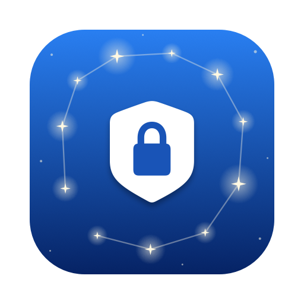
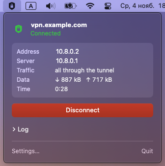
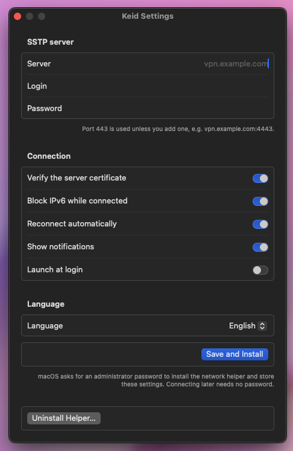

<p align="center">
  
</p>

<h1 align="center">Keid — SSTP VPN Client for macOS</h1>

<p align="center">
  SSTP VPN client for macOS for <b>Keenetic</b> (Netcraze), <b>MikroTik</b>, <b>Windows Server</b> and <b>SoftEther</b> routers.
</p>

<p align="center">
  macOS 14+ · Apple Silicon & Intel · no Homebrew, no Docker, no Terminal · English & Russian · MIT license
</p>

<p align="center">
  <a href="../../releases/latest"><b>Download the DMG</b></a> · <a href="README.ru.md">Русская версия</a>
</p>

<p align="center">
  
  &nbsp;&nbsp;
  
</p>

---

## Features

- **One click** to connect and disconnect from the menu bar; the icon shows the state at a glance.
- **Server, login and password in the app** — no config files, no Terminal.
- **All traffic through the tunnel** (full tunnel): IPv4 and DNS go through your home router, so its routing rules apply, including domain-based ones.
- **IPv6 leak protection:** IPv6 is blocked while connected, so nothing bypasses the VPN.
- **Kill-switch (firewall):** from **Connect** until **Disconnect**, nothing leaves the Mac outside the tunnel — not while connecting, not after a drop, a wrong password or any other failure, and not from apps bound to Wi-Fi. Only the SSTP server and the local network stay reachable.
- **Auto-reconnect** after a Wi-Fi change, sleep or a server restart — at once when the network returns or the Mac wakes, and a dead tunnel is noticed within 20 s; stops at once if the server rejects the password, so the account is not locked out.
- **Notifications** when the connection is lost or restored and when the login is rejected; traffic counters in the panel.
- **Strict TLS certificate check** by default (can be turned off for self-signed certificates).
- **Universal app:** Apple Silicon (M1, M2, M3, M4) and Intel Macs, macOS 14 Sonoma, 15 Sequoia and newer.
- **English and Russian interface**, switchable in Settings.
- Launch at login, a connection log in the panel (with a copy button), a clean uninstall.

## Works with

| Server | Notes |
|---|---|
| **Keenetic / Netcraze** routers (SSTP server, KeenDNS) | Tested. Enable the *SSTP VPN server* on the router and use its KeenDNS name |
| **MikroTik** RouterOS | SSTP server with MS-CHAPv2 |
| **Windows Server** RRAS | SSTP with MS-CHAPv2 |
| **SoftEther VPN** | SSTP enabled on the server |

Other SSTP servers with MS-CHAPv2 should work too — reports are welcome in [Issues](../../issues).

## Install

1. Download `Keid-<version>.dmg` from [Releases](../../releases/latest) and drag **Keid** into **Applications**.
2. Open it. The app is not notarized by Apple, so the first launch is blocked: open **System Settings → Privacy & Security** and click **Open Anyway** next to “Keid”.
3. Click the shield in the menu bar → **Open Settings…**, enter the server, login and password and click **Save and Install**. macOS asks for an administrator password once, to install the network helper.
4. Click **Connect**.

Connecting and disconnecting later needs no password. Changing the server asks for the administrator password again, so nobody else can redirect your tunnel.

## FAQ

**How do I connect a Mac to a Keenetic router over SSTP?**
In the Keenetic web interface install the *SSTP VPN server* component, enable it, allow VPN access for a user and turn on KeenDNS. In Keid enter the KeenDNS name (for example `myhome.keenetic.pro`) and that user's login and password.

**Why is KeenDNS slow?**
With a private ("grey") IP from your provider, KeenDNS works in *cloud* mode, which makes the tunnel slower. With a public IP and KeenDNS in *direct access* mode the tunnel runs at the full speed of your connection.

A grey IP usually means your provider uses **CGNAT** (carrier-grade NAT): many customers share one public address, so the router cannot be reached from the internet directly. To check, compare the WAN address in the Keenetic web interface with the one a site such as ifconfig.me shows. If they differ, or the WAN address is in `100.64.0.0/10` (`100.64.x.x`–`100.127.x.x`), `10.x.x.x`, `172.16.x.x`–`172.31.x.x` or `192.168.x.x`, you are behind CGNAT. Providers usually offer a public IP as a separate service.

**Does it work on Apple Silicon?**
Yes. The app and the bundled `sstpc` are universal binaries (arm64 + x86_64).

**Full tunnel or split tunnel?**
Full tunnel: all IPv4 traffic and DNS go through the VPN, so your router's rules decide where traffic goes.

**The VPN is down and nothing loads. Why?**
That is the kill-switch: traffic outside the tunnel stays blocked until the tunnel is back or you click **Disconnect** (or **Disconnect and unblock internet**). If the app is gone or broken, either restart the Mac or run in Terminal:

```bash
sudo -n /Library/PrivilegedHelperTools/sstp-mac-client/sstp-helper down
```

**Where is my password stored?**
In a root-only file (`/etc/sstp-mac-client/server.conf`, mode 600), never in the app's preferences. It never appears on a command line: the helper hands it to `sstpc` through stdin (a small patch to sstp-client, in `scripts/patches`).

## How it works

The app bundles [`sstpc`](https://gitlab.com/sstp-project/sstp-client), built statically with OpenSSL and libevent, and drives it through a small root helper. `sstpc` speaks SSTP over TLS and hands PPP to macOS's own `/usr/sbin/pppd`.

```
Keid.app (menu bar, runs as you)
   │  sudo -n sstp-helper up|down|status|log      ← sudoers rule, these 4 commands only
   ▼
/Library/PrivilegedHelperTools/sstp-mac-client/
   sstp-helper ── sstpc ── /usr/sbin/pppd ── ppp0 ── TLS:443 ──► SSTP server
```

| | |
|---|---|
| Routes | four `/2` routes via `ppp0` (more specific than the Wi-Fi default, which stays untouched), plus a `/32` to the SSTP server via the original gateway so the tunnel does not route into itself |
| DNS | the server's DNS becomes the system DNS while connected |
| Kill-switch | pf rules (restored within seconds if another program disables pf or flushes them) in the anchor `com.apple/sstp-mac-client` (`/etc/pf.conf` is not changed): outgoing traffic is allowed only through the tunnel, to the SSTP server, to the networks the Mac is directly attached to (not every private range), link-local/multicast and DHCP; everything else is refused, IPv6 included. On from Connect until Disconnect (or uninstall, or a restart of the Mac) |
| Server name | while the firewall is on, the server's address is resolved by the helper itself (`dig` as `nobody`, the only user the firewall lets reach the DNS servers — apps' DNS stays blocked) and written to `/etc/hosts` with a `# sstp-mac-client` mark; removed on Disconnect |
| IPv6 | `::/1` and `8000::/1` are rejected while connected (the tunnel carries IPv4 only); if they cannot be set, connecting fails |
| Credentials | `/etc/sstp-mac-client/server.conf`, root-only (600), written only through the administrator prompt |
| Helper | root-owned copies of the helper and `sstpc`; the app bundle itself never runs as root after setup |
| TLS | system root certificates (`/etc/ssl/cert.pem`); `sstpc` checks the certificate name against the server |

Uninstall: **Settings → Uninstall Helper…**, then drag the app to the Trash.

### Known limits

- The password cannot contain a double quote (`"`) or a backslash (`\`) — `sstpc` passes it to `pppd` unescaped.
- MS-CHAPv2 authentication only (the SSTP default); EAP and client certificates are not supported.
- IPv4 inside the tunnel only.

## Building from source

Requires macOS 14+, Command Line Tools (`xcode-select --install`) and `pkg-config` (`brew install pkgconf`).

```bash
make sstpc   # static universal sstpc (pinned, checksummed sources)
make dmg     # helper tests, build/Keid.app and build/Keid-<version>.dmg
make test    # helper tests + swift test (swift test needs Xcode for the Testing framework)
make icon    # redraw docs/icon.png and docs/social-preview.png
```

Signing for distribution: set `CODESIGN_IDENTITY="Developer ID Application: …"`, and `NOTARY_PROFILE` for notarization (see the comments in `scripts/`). CI (GitHub Actions, macOS 15) runs the tests on every push and attaches the DMG to a release for every `v*` tag.

## Project layout

| Path | Responsibility |
|---|---|
| `Sources/SSTPClient/` | The app: menu bar panel, Settings, connection state, auto-reconnect, network and wake monitoring, notifications, language switch |
| `Sources/SSTPCore/` | Logic covered by tests: helper status parsing, settings validation, the administrator prompt script, reconnect, notification and polling policies, traffic counters, language choice |
| `helper/sstp-helper` | Root helper: starts `sstpc`, the pf kill-switch, routes, DNS and the IPv6 block, reports status and the log |
| `helper/install-helper.sh` | Installs the helper, the root-only settings and the sudoers rule; uninstalls |
| `scripts/` | Build `sstpc`, the app and the DMG; draw the icon; helper tests |
| `scripts/patches/` | Our changes to sstp-client, applied when `sstpc` is built |
| `Resources/` | `Info.plist`, English and Russian strings |
| `Tests/` | Swift tests (Swift Testing) |

```
Sources/                app and core logic (Swift)
helper/                 root helper and installer (sh)
scripts/                build, icon and test scripts; patches/ for sstpc
Resources/              Info.plist, localizations
Tests/                  Swift tests
docs/                   icon and social preview for this README
.github/                CI workflow and Dependabot (for when the repository is hosted)
Makefile                sstpc, app, dmg, test, icon
CHANGELOG.md            what changed in each version
LICENSE                 MIT license
THIRD_PARTY_NOTICES.md  sstpc, OpenSSL, libevent
```

## Roadmap

Ideas for later, not promised:

- **Shortcuts and Siri** (App Intents): “Connect VPN” and “Disconnect VPN” in Shortcuts and Spotlight.
- **Several servers** (profiles) to switch between.
- **Certificate pinning** for self-signed servers: remember the certificate on the first connect and warn when it changes, instead of turning the check off.
- **Unit tests for the connection model** (needs Xcode to run).

## License

[MIT](LICENSE) © 2026 MartyStev. The bundled `sstpc` is GPL-3.0, with OpenSSL (Apache-2.0) and libevent (BSD) linked statically; see [THIRD_PARTY_NOTICES.md](THIRD_PARTY_NOTICES.md).

<sub>SSTP client for Mac · SSTP VPN macOS · Keenetic VPN on Mac · KeenDNS VPN · Netcraze VPN · MikroTik SSTP on macOS · Windows SSTP VPN for Mac · SoftEther SSTP · sstpc GUI for macOS · SSTP on Apple Silicon · remote access to a home network from a MacBook</sub>
