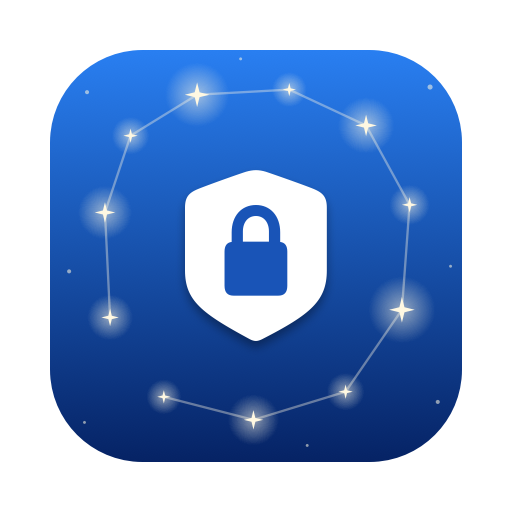

<p align="center">
  
</p>

<h1 align="center">Keid — SSTP VPN Client для macOS</h1>

<p align="center">
  SSTP VPN клиент для macOS для роутеров <b>Keenetic</b> (Netcraze), <b>MikroTik</b>, <b>Windows Server</b> и <b>SoftEther</b>.
</p>

<p align="center">
  macOS 14+ · Apple Silicon и Intel · без Homebrew, Docker и терминала · русский и английский · лицензия MIT
</p>

<p align="center">
  <a href="../../releases/latest"><b>Скачать DMG</b></a> · <a href="README.md">English</a>
</p>

---

## Возможности

- **Один клик** — подключение и отключение из строки меню; по иконке сразу видно состояние.
- **Сервер, логин и пароль вводятся в приложении** — без конфигов и терминала.
- **Весь трафик через туннель** (full tunnel): IPv4 и DNS идут через домашний роутер, поэтому работают его правила маршрутизации, в том числе по доменам.
- **Защита от утечек IPv6:** на время подключения IPv6 блокируется, ничего не идёт мимо VPN.
- **Kill-switch (фаервол):** от **Подключить** до **Отключить** ничего не уходит с Mac мимо туннеля: ни во время подключения, ни после обрыва, неверного пароля или другого сбоя, ни от приложений, привязанных к Wi-Fi. Доступны только SSTP-сервер и локальная сеть.
- **Автоматическое переподключение** после смены Wi-Fi, сна или перезапуска сервера — сразу, как только вернулась сеть или Mac проснулся, а «мёртвый» туннель обнаруживается за 20 с; если сервер отклонил пароль, попытки сразу прекращаются, чтобы учётную запись не заблокировали.
- **Уведомления** о потере и восстановлении соединения и об отклонённом логине; счётчики трафика в панели.
- **Строгая проверка TLS-сертификата** по умолчанию (для самоподписанных можно отключить).
- **Универсальное приложение:** Apple Silicon (M1, M2, M3, M4) и Intel, macOS 14 Sonoma, 15 Sequoia и новее.
- **Интерфейс на русском и английском**, язык переключается в настройках.
- Запуск при входе, журнал подключения в панели (с кнопкой копирования), чистое удаление.

## С чем работает

| Сервер | Заметки |
|---|---|
| Роутеры **Keenetic / Netcraze** (SSTP-сервер, KeenDNS) | Проверено. Включите на роутере *SSTP VPN-сервер* и используйте его имя KeenDNS |
| **MikroTik** RouterOS | SSTP-сервер с MS-CHAPv2 |
| **Windows Server** RRAS | SSTP с MS-CHAPv2 |
| **SoftEther VPN** | с включённым SSTP |

Другие SSTP-серверы с MS-CHAPv2 тоже должны работать — пишите об опыте в [Issues](../../issues).

## Установка

1. Скачайте `Keid-<версия>.dmg` из [Releases](../../releases/latest) и перетащите **Keid** в **Программы**.
2. Откройте его. Приложение не нотаризовано Apple, поэтому первый запуск будет заблокирован: откройте **Системные настройки → Конфиденциальность и безопасность** и нажмите **Всё равно открыть** рядом с «Keid».
3. Нажмите на щит в строке меню → **Открыть настройки…**, укажите сервер, логин и пароль и нажмите **Сохранить и установить**. macOS один раз попросит пароль администратора, чтобы установить сетевой помощник.
4. Нажмите **Подключить**.

Дальше подключение и отключение пароля не требуют. Смена сервера снова попросит пароль администратора — чтобы никто другой не мог перенаправить ваш туннель.

## Вопросы и ответы

**Как подключить Mac к роутеру Keenetic по SSTP?**
В веб-интерфейсе Keenetic установите компонент *SSTP VPN-сервер*, включите его, разрешите пользователю доступ к VPN и включите KeenDNS. В Keid укажите имя KeenDNS (например, `myhome.keenetic.pro`), логин и пароль этого пользователя.

**Почему через KeenDNS медленно?**
Если провайдер выдаёт «серый» IP, KeenDNS работает в *облачном* режиме, и туннель из-за этого медленнее. С белым IP и режимом KeenDNS «Прямой доступ» туннель работает на полной скорости вашего подключения.

«Серый» IP обычно означает, что провайдер использует **CGNAT** (Carrier-Grade NAT, NAT операторского уровня): один внешний адрес делят много абонентов, и подключиться к роутеру из интернета напрямую нельзя. Как проверить: сравните адрес WAN в веб-интерфейсе Keenetic с тем, что показывает, например, 2ip.ru. Если они разные или адрес WAN из диапазона `100.64.0.0/10` (`100.64.x.x`–`100.127.x.x`), `10.x.x.x`, `172.16.x.x`–`172.31.x.x` или `192.168.x.x`, вы за CGNAT. Белый IP обычно можно заказать у провайдера как отдельную услугу.

**Работает ли на Apple Silicon?**
Да. Приложение и встроенный `sstpc` — универсальные (arm64 + x86_64).

**Весь трафик или только часть?**
Весь: IPv4 и DNS идут через VPN, а куда трафик пойдёт дальше, решают правила вашего роутера.

**VPN не работает, и ничего не открывается. Почему?**
Это kill-switch: трафик мимо туннеля заблокирован, пока туннель не восстановится или вы не нажмёте **Отключить** (или **Отключить и разблокировать интернет**). Если приложение недоступно, перезагрузите Mac или выполните в Терминале:

```bash
sudo -n /Library/PrivilegedHelperTools/sstp-mac-client/sstp-helper down
```

**Где хранится пароль?**
В файле, доступном только root (`/etc/sstp-mac-client/server.conf`, права 600), и никогда в настройках приложения. В командной строке он не появляется никогда: помощник передаёт его `sstpc` через stdin (небольшой патч к sstp-client, в `scripts/patches`).

## Как это устроено

Приложение несёт в себе [`sstpc`](https://gitlab.com/sstp-project/sstp-client), собранный статически с OpenSSL и libevent, и управляет им через небольшой root-помощник. `sstpc` говорит по SSTP поверх TLS и передаёт PPP системному `/usr/sbin/pppd`.

```
Keid.app (строка меню, работает от вашего имени)
   │  sudo -n sstp-helper up|down|status|log      ← правило sudoers только на эти 4 команды
   ▼
/Library/PrivilegedHelperTools/sstp-mac-client/
   sstp-helper ── sstpc ── /usr/sbin/pppd ── ppp0 ── TLS:443 ──► SSTP-сервер
```

| | |
|---|---|
| Маршруты | четыре маршрута `/2` через `ppp0` (точнее маршрута Wi-Fi, сам он не меняется) и `/32` до SSTP-сервера через исходный шлюз, чтобы туннель не ушёл сам в себя |
| DNS | на время подключения DNS сервера становится DNS всей системы |
| Kill-switch | правила pf (восстанавливаются за секунды, если другая программа выключит pf или сотрёт их) в якоре `com.apple/sstp-mac-client` (`/etc/pf.conf` не меняется): наружу разрешено только через туннель, до SSTP-сервера, в сети, к которым Mac подключён напрямую (а не во все частные диапазоны), link-local/multicast и DHCP; всё остальное отклоняется, включая IPv6. Действует от «Подключить» до «Отключить» (или удаления помощника, или перезагрузки Mac) |
| Имя сервера | пока фаервол включён, адрес сервера определяет сам помощник (`dig` от пользователя `nobody`, единственного, кого фаервол пускает к DNS-серверам, — DNS приложений остаётся заблокированным) и записывает его в `/etc/hosts` с меткой `# sstp-mac-client`; запись удаляется при отключении |
| IPv6 | `::/1` и `8000::/1` отклоняются на время подключения (туннель несёт только IPv4); если их не удалось поставить, подключение не выполняется |
| Учётные данные | `/etc/sstp-mac-client/server.conf`, только root (600), пишутся только через запрос пароля администратора |
| Помощник | копии помощника и `sstpc`, принадлежащие root; после установки само приложение от root не запускается |
| TLS | системные корневые сертификаты (`/etc/ssl/cert.pem`); `sstpc` сверяет имя в сертификате с сервером |

Удаление: **Настройки → Удалить помощник…**, затем перетащите приложение в Корзину.

### Ограничения

- Пароль не может содержать двойную кавычку (`"`) и обратную косую черту (`\`) — `sstpc` передаёт его в `pppd` без экранирования.
- Только авторизация MS-CHAPv2 (стандарт для SSTP); EAP и клиентские сертификаты не поддерживаются.
- Внутри туннеля только IPv4.

## Сборка из исходников

Нужны macOS 14+, Command Line Tools (`xcode-select --install`) и `pkg-config` (`brew install pkgconf`).

```bash
make sstpc   # статический универсальный sstpc (исходники с проверкой SHA-256)
make dmg     # тесты помощника, build/Keid.app и build/Keid-<версия>.dmg
make test    # тесты помощника + swift test (для swift test нужен Xcode)
make icon    # перерисовать docs/icon.png и docs/social-preview.png
```

Подпись для распространения: `CODESIGN_IDENTITY="Developer ID Application: …"` и `NOTARY_PROFILE` для нотаризации (см. комментарии в `scripts/`). CI (GitHub Actions, macOS 15) гоняет тесты на каждый push и прикладывает DMG к релизу для каждого тега `v*`.

## Структура проекта

| Путь | За что отвечает |
|---|---|
| `Sources/SSTPClient/` | Приложение: панель в строке меню, настройки, состояние подключения, переподключение, слежение за сетью и сном, уведомления, выбор языка |
| `Sources/SSTPCore/` | Логика с тестами: разбор статуса помощника, проверка настроек, скрипт запроса прав, правила переподключения, уведомлений и частоты опроса, счётчики трафика, выбор языка |
| `helper/sstp-helper` | Root-помощник: запускает `sstpc`, kill-switch на pf, маршруты, DNS и блокировку IPv6, отдаёт статус и журнал |
| `helper/install-helper.sh` | Устанавливает помощник, настройки (только root) и правило sudoers; удаляет их |
| `scripts/` | Сборка `sstpc`, приложения и DMG; иконка; тесты помощника |
| `scripts/patches/` | Наши изменения sstp-client, применяются при сборке `sstpc` |
| `Resources/` | `Info.plist`, русские и английские строки |
| `Tests/` | Тесты на Swift (Swift Testing) |

## Планы

Идеи на будущее, без обещаний:

- **Быстрые команды и Siri** (App Intents): «Подключить VPN» и «Отключить VPN» в «Быстрых командах» и Spotlight.
- **Несколько серверов** (профили) с переключением.
- **Закрепление сертификата** для самоподписанных серверов: запомнить сертификат при первом подключении и предупредить, если он изменится, вместо отключения проверки.
- **Модульные тесты модели подключения** (для запуска нужен Xcode).

## Лицензия

[MIT](LICENSE) © 2026 MartyStev. Встроенный `sstpc` распространяется под GPL-3.0, OpenSSL (Apache-2.0) и libevent (BSD) слинкованы статически; см. [THIRD_PARTY_NOTICES.md](THIRD_PARTY_NOTICES.md).

<sub>SSTP клиент для Mac · SSTP VPN macOS · VPN Keenetic на Mac · подключение к Keenetic через KeenDNS · Netcraze VPN · MikroTik SSTP на macOS · SSTP VPN Windows для Mac · SoftEther SSTP · графический интерфейс sstpc для macOS · SSTP на Apple Silicon · удалённый доступ к домашней сети с MacBook</sub>
